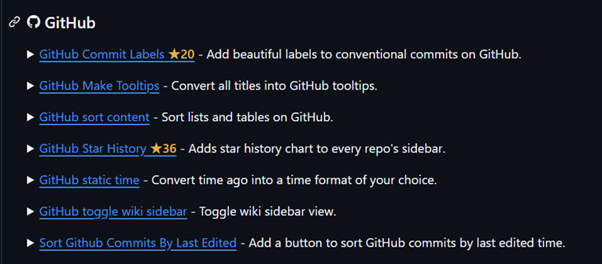

# GitHub Star

A userscript that shows GitHub repository star counts next to repo links on any web page.

Browse Hacker News, Reddit, blog posts, or awesome-lists, and every link to a GitHub repository gets a ★ badge with its current star count — no need to open the repo to see how popular it is.

via [Awesome Userscripts](https://github.com/awesome-scripts/awesome-userscripts#-github)

## Features

- Works on every site (github.com links found anywhere in the page)
- Badges are injected via CSS only — no DOM nodes are inserted, so React/Vue pages don't break
- Star counts are cached for 24 hours and shared across all sites
- Handles GitHub API rate limits gracefully: backs off and serves cached values instead of dropping badges
- Detects links added after page load (SPA navigation, infinite scroll)

## Installation

1. Install a userscript manager:
   - [Violentmonkey](https://violentmonkey.github.io/)
   - [Tampermonkey](https://www.tampermonkey.net/)
2. Click to install the script:

   **[Install github-star.user.js](https://raw.githubusercontent.com/oooooooo/github-star.user.js/main/github-star.user.js)**

   Your userscript manager will pick it up and show an install prompt. Updates are delivered automatically from this repository.

## Optional: GitHub access token

Without a token, the GitHub API allows 60 requests per hour, which is fine for light browsing (results are cached). To raise the limit to 5,000/hour:

1. Create a [fine-grained personal access token](https://github.com/settings/personal-access-tokens) — read-only access to starring is enough; no other permissions are needed
2. Open the userscript manager menu on a trusted page (for example `https://github.com`) and choose **Set GitHub access token**. If the script appears grayed out, reload the page first — the menu only appears on tabs where the script has run
3. Paste the token

The token is stored in the userscript manager's storage, never in the script source. The dialog never shows the saved token; to remove it, choose **Clear GitHub access token**.

## License

[MIT](LICENSE)
